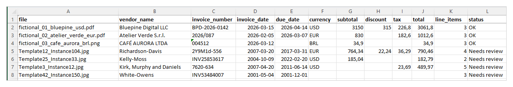
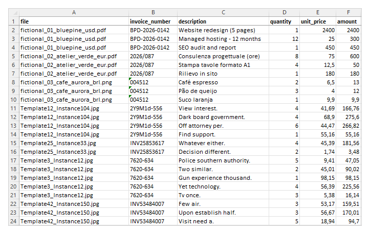
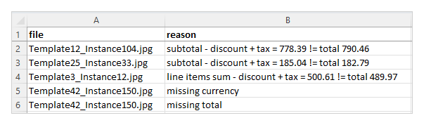

# AI Invoice Parser

Python CLI that reads a folder of invoices and receipts (PDF, JPG, PNG) in **different layouts**, uses the Claude API to extract structured data, validates the totals, flags documents that need review, and exports everything to a formatted Excel file.

**Extracted fields:** vendor, invoice number, invoice date, due date, currency, line items (description, quantity, unit price, amount), subtotal, discount, tax, total.

> This is the AI-based follow-up to [pdf-statement-extractor](https://github.com/gabrielbf7/pdf-statement-extractor), which uses fixed rules and only works with one layout. Here, a language model reads each document, so a new vendor layout does not require new code.

## Features

- **Layout-independent extraction:** the same prompt handles scanned images, digital PDFs, photos of receipts, different languages and number formats (e.g., `1.012,60` in Italian invoices).
- **Guaranteed output format:** the model is forced to answer through a tool with a strict JSON schema, so every response has the same fields (missing values come back as `null`, never guessed).
- **Validation:** checks required fields and the math (line items vs. subtotal, subtotal − discount + tax vs. total, with a 0.01 tolerance). Documents that fail go to a `Needs review` sheet with the reason.
- **Cost report:** every run prints the tokens used and the estimated API cost.
- **Batch-safe:** a failure on one file is recorded and the run continues with the next one.
- **Clean output:** bold frozen header, real Excel dates, auto-sized columns.

## How it works

1. `cli.py` lists the PDF/JPG/PNG files in the given folder.
2. `invoice_parser/extractor.py` sends each file (base64, no local OCR or PDF library) to the Claude API with a system prompt and the `record_invoice` tool defined in `schema.py`. It returns the extracted data and the token counts. This is the only module that calls the API.
3. `invoice_parser/validator.py` returns a list of review reasons (empty list = OK).
4. `invoice_parser/cost.py` turns input/output tokens into an estimated cost for the model used.
5. `invoice_parser/exporter.py` writes the Excel file with three sheets:
   - `Invoices` – one row per document
   - `Line items` – one row per item, linked to its file
   - `Needs review` – documents that failed validation, with the reasons

## Tech Stack

- Python 3.12
- AI: Claude API (Anthropic), model `claude-haiku-5-5`, with tool use and strict JSON schema for structured output
- anthropic (official Python SDK)
- openpyxl (Excel export)
- python-dotenv (loads the API key from `.env`)
- pytest (tests)

## Setup

You need a Claude API key from the [Claude Console](https://console.anthropic.com).

```
python -m venv venv
venv\Scripts\activate
pip install -r requirements.txt
copy .env.example .env
```

Open `.env` and set your key:

```
ANTHROPIC_API_KEY=your-key-here
```

`.env` is listed in `.gitignore`, so the key is never committed. On macOS/Linux, use `source venv/bin/activate` and `cp` instead of `copy`.

## Usage

```
python cli.py samples/
python cli.py samples/ --output output/my_invoices.xlsx
```

Without `--output`, the file is saved as `output/invoices_<timestamp>.xlsx`.

Run the tests (no API calls, no cost):

```
python -m pytest
```

## Sample output

Run on the 7 files in `samples/`:

```
[1/7] fictional_01_bluepine_usd.pdf ... OK
[2/7] fictional_02_atelier_verde_eur.pdf ... OK
[3/7] fictional_03_cafe_aurora_brl.png ... OK
[4/7] Template12_Instance104.jpg ... needs review (1 issue(s))
[5/7] Template25_Instance33.jpg ... needs review (1 issue(s))
[6/7] Template3_Instance12.jpg ... needs review (1 issue(s))
[7/7] Template42_Instance150.jpg ... needs review (2 issue(s))

Files processed: 7 | OK: 3 | Needs review: 4
Tokens: 17,483 input / 2,904 output
Estimated API cost: US$ 0.0032
Excel saved to: output\invoices_20261021_161129.xlsx
```

**Result: 3/3 valid documents extracted correctly; 4/4 inconsistent documents correctly flagged for review.**

| File | Tests | Result |
|---|---|---|
| `fictional_01_bluepine_usd.pdf` | digital PDF, USD, discount + sales tax | OK (3,150.00 − 315.00 + 226.80 = 3,061.80) |
| `fictional_02_atelier_verde_eur.pdf` | Italian, EUR, decimal comma, DD/MM dates | OK (830.00 + 182.60 = 1,012.60) |
| `fictional_03_cafe_aurora_brl.png` | skewed receipt photo, BRL, no tax | OK (34.90) |
| `Template3_Instance12.jpg` | no subtotal, VAT | Review: items − discount + tax = 500.61 ≠ total 489.97 |
| `Template12_Instance104.jpg` | discount, EUR | Review: subtotal − discount + tax = 778.39 ≠ total 790.46 |
| `Template25_Instance33.jpg` | 5 GST lines | Review: subtotal − discount + tax = 185.04 ≠ total 182.79 |
| `Template42_Instance150.jpg` | no subtotal, tax or total | Review: missing currency, missing total |

Excel output (`Invoices`, `Line items` and `Needs review` sheets):







The four FATURA samples are expected to fail: the dataset is synthetic and its amounts do not always add up. They show that the validator catches inconsistent documents instead of passing them silently. The model copied the printed values; it did not "fix" them.

## Cost

Measured with `claude-haiku-5-5` (US$ 0.10 per million input tokens, US$ 0.50 per million output tokens):

- One single-page invoice uses about 2,100–3,300 input tokens (images are smaller than PDFs) and 400–500 output tokens.
- 7 invoices: 17,483 input + 2,904 output tokens = **US$ 0.0032** (about US$ 0.0005 per invoice).
- Estimate for 1,000 single-page invoices: about US$ 0.50.

Prices change; update `invoice_parser/cost.py` if needed. Set a monthly spend limit in the Claude Console.

## Limitations

- **Values are copied, not corrected:** if the document itself is wrong, the data will be wrong too (it will be flagged for review if the math does not match).
- **Tax is a single total:** multiple taxes (e.g., several GST lines) are summed into one `tax` field.
- **No `other_charges` field:** tips, shipping or service fees that are not line items will make the total check fail.
- **Tested on 7 documents**, mostly single-page. Long multi-page invoices and very low-quality scans are untested.
- **Not for bank or credit card statements:** they need a different schema.
- LLM output is probabilistic: review flagged documents and spot-check the others before using the data in accounting.

## Privacy

- **Documents leave your computer:** every file is uploaded to the Anthropic API for processing. Do not process documents you are not allowed to share with a third-party service. See Anthropic's commercial terms and privacy policy for data handling.
- The API key stays in `.env` and is never committed.
- This repository only contains fictional documents and samples from a public dataset. No real invoices are published.

## Sample sources

- `fictional_*` files: fictional documents created for this project. Companies, people and amounts are invented.
- `Template*_Instance*.jpg` files: from the **FATURA** dataset – *FATURA: A Multi-Layout Invoice Image Dataset for Document Analysis and Understanding* (Limam, Dhiaf, Kessentini, 2023, [arXiv:2311.11856](https://arxiv.org/abs/2311.11856)), available on [Zenodo](https://zenodo.org/records/10371464) under the [CC BY 4.0](https://creativecommons.org/licenses/by/4.0/) license. Files are used unmodified.

## Author

Gabriel Fantin - [GitHub](https://github.com/gabrielbf7)